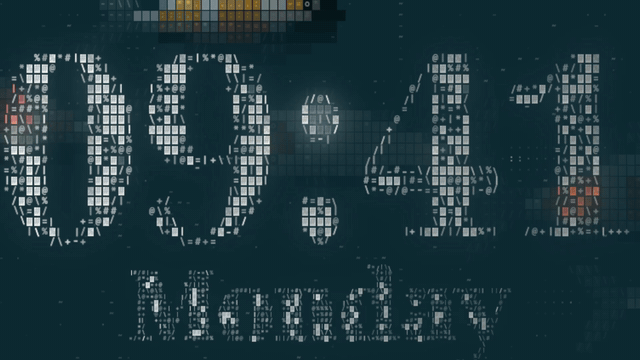

# ASCII Koi

**Your new tab is a koi pond.** Up to fourteen koi, drawn entirely in text characters, swimming under a clock made of the same characters. Poke the water with a cat paw. Feed the fish. Watch them race for it.

  

  <a href="https://pursurer.github.io/ascii-koi/"><b>▶ Open the live pond</b></a> &nbsp;·&nbsp;
  <a href="https://github.com/pursurer/ascii-koi/releases/latest/download/ascii-koi-film.mp4">Watch the 60 fps film</a> &nbsp;·&nbsp;
  <a href="#make-it-your-new-tab">Install as your new tab (30 seconds)</a>

## What you can do

| | |
|---|---|
| **Left click** | A black cat paw reaches in from the edge, hooks the water back in two tugs and flicks out a spray of drops. The koi bolt. A moment later the curious ones swim back to look. |
| **Right click** | A handful of fish food. Every pellet lands with its own ring, the hungry koi rise to the surface and race each other to eat. |
| **Tap / hold** | The same on a phone or tablet: tap for the paw, hold for food. |
| **`1` `2` `3` or `T`** | Three waters: **pond** (deep lake teal), **black** and **light**. The new water spreads out like a ripple from where you chose it. |
| **`Space`** | Freeze the pond. |

The clock is not a font. It is the outline of Noto Serif Display sampled into character cells: the contour becomes `| / - \` strokes, the strokes become solid tiles, and every koi that swims underneath tints the digits in its own colours while a caustic light net plays across them.

## Make it your new tab

Chrome, Edge, Brave, Arc and every other Chromium browser:

1. Get the folder: `git clone https://github.com/pursurer/ascii-koi.git` (or **Code → Download ZIP** and unzip it).
2. Open `chrome://extensions` and switch on **Developer mode**.
3. Click **Load unpacked** and pick the `ascii-koi` folder.

Open a new tab. You have a pond.

Any other browser: set your home page to **https://pursurer.github.io/ascii-koi/**.

## Make it yours

| URL | What it does |
|---|---|
| `?theme=pond` · `black` · `light` | Start in that water (your last choice is remembered) |
| `themes/light.html` | A page locked to one water |
| `?title=One%20Page&tag=is%20all%20you%20need` | Your own words instead of the clock |
| `?ui=0` | No controls: a wallpaper, a second screen, a stream background |

## How it works

- **Koi.** Each fish is a chain of ten spine nodes trailing its head, with a travelling body wave. Every character cell is sampled against the nearest point on the spine (plus sub-samples for soft edges), classified as body, fin, eye or barbel, coloured by the fish's own markings (kohaku, sanke, tancho) and shaded by a light from the upper left: lit skin gets sparse glyphs, shadowed skin dense ones. Each koi casts a shadow on the pond floor and leaves a wake.
- **Water.** Two drifting noise fields; where they meet, light gathers in a thin moving net of `· - ~`, and the scales glint `*` where it crosses a back.
- **Deterministic.** For a recording the simulation steps forward in fixed 1/60 s steps, so the same events always give the same frame. The film above was rendered frame by frame from this exact engine with [huashu-motion](https://github.com/alchaincyf/huashu-motion); nothing in it is mocked up.
- **Small.** Vanilla JavaScript, no build step, no dependencies: `pond.js` (the engine) and `app.js` (the page) are about 1,200 lines together, plus two web fonts (37 KB).

## Credits

- Technique informed by [stackedlol/ascii-sharks](https://github.com/stackedlol/ascii-sharks) (MIT) and [daoho.dev](https://daoho.dev); all code here is written for this project.
- Fonts: [Noto Serif Display](https://fonts.google.com/noto/specimen/Noto+Serif+Display) and [Geist Mono](https://github.com/vercel/geist-font), both under the SIL Open Font License (see `fonts/`).
- Film: made with [huashu-motion](https://github.com/alchaincyf/huashu-motion).

## License

MIT. Fork it, theme it, put it on your stream. If the pond made you smile, **⭐ star the repo** so the next person finds it too.
